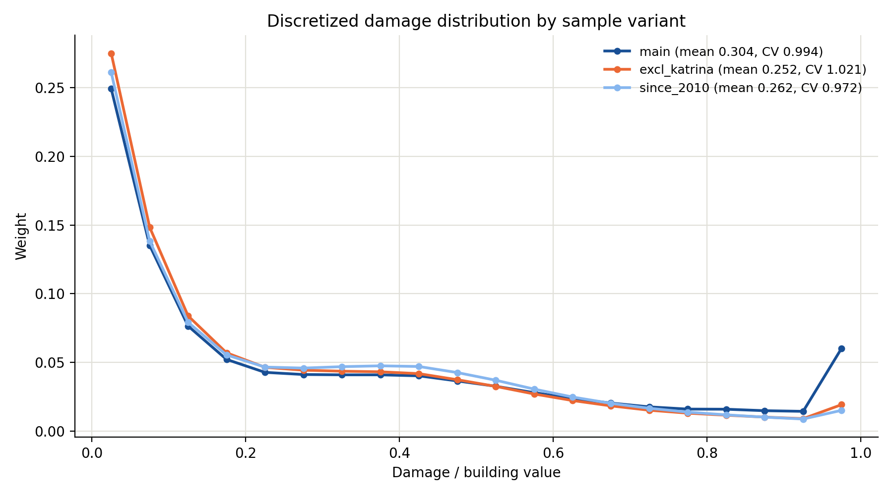

# Model Parameters — what we need to calibrate

*The **Value** column is what the **current code and paper use** (calibration of 2026-11-07); **Value
(G&S)** is the Gruber–Solomon (NBER WP 35408) estimate where one exists; **Source (G&S)** is how G&S
identify it; **Reasoning** says whether we adopt G&S and, if not, why. Continuous-damage parameters
are folded into §1b, tagged **[cont]**. §2 lists quantities that are **not model inputs** but are
useful consistency checks. G&S page refs are printed pages (PDF page = printed + 2). Cross-refs:
`draft/paper.tex` (§4 and Table 1), `code/params.py` (single source of truth),
`code/belief_identification.py`, `lit/gruber_solomon.md`. Open issues, to-dos and current results
are tracked in `notes/calibration_overview.md`; this note documents the parameters and their G&S
counterparts.*

---

## 1a. Structural / preference parameters
| Symbol | Meaning | Value | Source | Value (G&S) | Source (G&S) | Reasoning |
|---|---|---|---|---|---|---|
| $\gamma$ | CRRA risk aversion | **1.5** (robustness 1 / 3; was 2) | Decision 2026-11-07, paper §4: between Chetty (2006, mean ≈ 1) and Szpiro (1986, 1.2–1.8 for the US). Not from insurance choices, which imply triple-digit values (Sydnor 2010; Collier et al. 2017; Barseghyan et al. 2013) | CARA $5\times10^{-4}$ | deductible-choice lit (Cohen–Einav, Sydnor), calibrated | **Not using G&S** — different functional form (CARA vs CRRA); implies implausibly high RRA at annual scale. |
| $w$ | household resources (utility base) | 1 (normalised) = **home value incl. land** | Decision 2026-11-07, paper §4 | — | not estimated | **No G&S value.** Damages are measured relative to home value; equivalent to an income base with pass-through MPC ≈ income/home value ≈ 0.25 (Kaplan et al. 2020 ratio ≈ 4). Code still uses building value until the `_home` files exist (§1b). |

## 1b. Flood-risk / loss primitives  (discrete baseline + [cont] additions)
| Symbol | Meaning | Value | Source | Value (G&S) | Source (G&S) | Reasoning |
|---|---|---|---|---|---|---|
| $p$ | true annual flood probability | paper **0.019**; code **0.02** | paper: NFIP claims ÷ policies in force in floodplains (`run_flood_arrival_rate.py`); code: round value | ≈ 0.055 | $p_f=\sigma_{PDD}\bar P/L_f$, §9.1 p. 31, App. B.22 p. 105 | **Not using G&S** — their value is implied by the premium–damage identity for the NFIP-insured sample (a different object). **Pending:** recompute as claims per policy-year for A/V zones with the same filters and years as $G$ (`calibration_overview.md` 3.1). |
| $\bar d=\mathbb{E}[D]$ | (mean) flood damage, share of resources | 0.15 (discrete); **0.3044 (cont., FEMA main; 0.2517 excl. Katrina)** | discrete: G&S $L_f$ anchor; continuous: FEMA claims, damage/building value | \$29,267 ($L_f$) | NFIP loss data (loss given flood) | The two damage models are **not mean-matched**. **Pending:** both switch to damage relative to home value incl. land once the `_home` variants are computed (`calibration_overview.md` 3.2). |
| CV **[cont]** | coeff. of variation of $D$ ($=\sigma_D/\bar d$) | **0.99 (main); 1.02 (excl. Katrina)** | FEMA claims | — | not estimated | **Estimated.** Empirical CV ≈ 1.0 in every sample variant. |
| $D_{\max}$ **[cont]** | maximum damage (share of base) | 0.993 (top-bin mean; no cap imposed) | FEMA claims | — | not estimated | **No cap so far.** The near-total-loss atom drives the continuous model's aid MVPF (20 at baseline); a loss cap at home equity is the recommended fix, decision **open** (`calibration_overview.md` 3.3). Excl. Katrina is the tail robustness check (paper §4). |
| family **[cont]** | functional form of $G$ | **empirical 20-bin histogram** (FEMA claims) | `fema_data_analysis/output/` | — | only scalar $L_f$ | **Estimated** — $D=$ buildingDamageAmount/buildingPropertyValue, single-family SFHA claims since 2000 ($n=813$k main / 712k excl. Katrina), 20 bins of width 0.05 at their conditional means. Loaded via `configure_damage(empirical=…)`; the Beta mode remains available for comparisons. |

**Reading the y-axis (bin weights).** Each point is a bin *probability* (weights sum to 1 across the
20 bins of width 0.05). The distribution is strongly right-skewed with a spike at total loss: the
top bin ($D\ge0.95$, mean 0.993) carries **6.0%** of the mass in the main sample (**1.9%** excl.
Katrina) — under CRRA this atom is where aid's tail-insurance value lives.

**The empirical distribution (wired in via `configure_damage(empirical=…)`).** $G$ is the 20-bin
discretization of $D=$ buildingDamageAmount$/$buildingPropertyValue over single-family SFHA claims
since 2000 (`fema_data_analysis/output/damage_distribution_main.csv`; `…_excl_katrina.csv` as tail
robustness). Expectations in the model are exact weighted sums over the bin conditional means; the
discretization reproduces the raw mean exactly and the raw CV to within 0.002. Key caveats (full
discussion: `fema_data_analysis/notes/notes.md`): **(i)** the denominator is *depreciated building
value* (ACV), not home value, so the ratio overstates damage relative to the utility base (fixed by
the land-share adjustment below); **(ii)** the distribution is conditional on a *claim*, not a flood,
so $p$ must be the claim frequency per policy-year in the same sample (`calibration_overview.md`
3.1); **(iii)** Katrina alone carries about 70% of the near-total losses (hence the excl. Katrina
variant); **(iv)** the sample pools elevated and non-elevated homes.

**Utility base = home value including land (decision 2026-11-07).**
- **Measure:** damage relative to home value is damage/structure value × (1 − FHFA land share), from Davis et al. (2019), FHFA WP 19-01, matched by tract, ZIP, county or state. This uses the `_home` variants of `run_compute_damage_distribution.py` (Taco's branch, merged locally in `69a1669`).
- **Interpretation:** an income base with pass-through MPC ≈ income/home value ≈ 0.25. The `scale` argument of `configure_damage` implements other (MPC, base) choices (`fema_data_analysis/notes/calibration_decisions.md`, App. A).
- **Paper:** described in §4.
- **Pending:** the code keeps the building-value base until the `_home` files are computed (paths `params.FEMA_DIST_*_HOME`; `calibration_overview.md` 3.2).

**Population and $p$.** The population is SFHA homeowners (decision 2026-11-07). The paper's $p=0.019$
comes from all NFIP claims per policy in force in floodplains and is not yet matched to the damage
sample; the code uses 0.02. G&S's premium and loss levels imply a higher rate ($p\approx0.04$ net of
the expense allowance, 0.055 in their own calculation); see §2 and `calibration_overview.md` 3.1.

## 1c. Policy parameters (status-quo evaluation point)
| Symbol | Meaning | Value | Source | Value (G&S) | Source (G&S) | Reasoning |
|---|---|---|---|---|---|---|
| $s$ | insurance subsidy rate (vs expected claims) | **0.22** (robustness 0 / 0.46; was 0.47) | decision 2026-11-07: $1-944/(0.7\cdot1739)$, i.e. G&S premiums with the ≈30% WYO expense allowance in the full-risk premium netted out (GAO-23-105977) | 0.46 ($1-944/1739$) | pre-RR2.0 vs RR2.0 full-risk premiums | **Not using G&S's 0.46 directly** — it is measured against the loaded full-risk premium (expense allowance, loss adjustment, reinsurance, risk load), not expected claims. 0.22 is an upper bound; counting fees gives about 0. To validate with FEMA data (`calibration_overview.md` 3.1). |
| $a$ | disaster-aid fraction | **0.052** (range 0.010–0.095; 0.12 upper bound) | decision 2026-11-07: bottom-up IHP grants + SBA home loans at subsidy value (`calibration_a_two_methods.md`; paper §4) | 0.133 ($f$) | App. B.22 p. 105: $f=|\beta_{cond}|/(\sigma_{PDD}\bar P)$; IV spillover $-\$216$/house/1pp | **Not using G&S's 0.133** — it measures how total federal outlays respond to coverage (incl. HMGP, GSE and NFIP interactions), not the transfer per dollar of damage; their own per-house aid amounts imply 0.031–0.036. Their IHP + SBA estimate (0.12) is the upper-bound robustness value. National rate applied to the SFHA population. |

## 1d. Behavioural / belief inputs

| Symbol | Meaning | Value | Source | Value (G&S) | Source (G&S) | Reasoning |
|---|---|---|---|---|---|---|
| $I$ | insurance take-up rate | **0.484** | Amornsiripanitch et al. (2025), SFHA, share of expected damages insured (2023) | 0.18 (risk-wtd); 0.05 (nat'l) | NFIP coverage counts | **Population = SFHA homeowners (decision 2026-11-07).** Includes mandated and voluntary demand (was 0.30). G&S's national 0.18 remains only in the $a$ calculation, whose denominator is national. |
| $\phi$ | mandated share | **0.32** | 0.39 (Mulder 2024 survey) × 0.484/0.595 | — | — | **Implemented 2026-11-07:** $I=\phi+(1-\phi)(1-F(q^*))$. Voluntary take-up 0.24. Cancels out of the local MVPFs. **Verified** in Mulder (2024) App. F, p. 74: 39% of floodplain homeowners report being subject to the mandate; the "≈54%" cited earlier is 39/72 with Mulder's own 72% take-up. |
| $\varepsilon$ | premium elasticity of total take-up (relative) | **−0.25** (bounds −0.177 / −0.32) | **decision 2026-11-07**: G&S SFHA subsample and Wagner (2022), both −0.25 | −0.32 (−0.25 SFHA) | FOIA policy-level panel; within-policy variation from 18%/yr cap, contract FE (§5 p. 19, Table 3) | **SFHA value, relative reading ("Reading A")**: G&S's renewal coefficient equals $\varepsilon$ through the threshold model. Implied voluntary elasticity −0.74 at $\phi=0.32$. Mulder's −0.37 uses his 72% take-up; on our base his −0.177 gives −0.52, so $\phi$ and $\varepsilon$ are consistent. Wagner's −0.25 verified in his online appendix (E, p. 17; A/V zones). |
| $F(q)$ | belief distribution (voluntary segment) | Beta **fitted to $(I,\varepsilon)$** | paper §3.6 two-moment strategy | — | no belief distribution (uniform wedge only) | The two Beta parameters are exactly identified by (voluntary take-up, density at the margin). Surveys are *validation benchmarks, not calibration inputs*. Used only for the optimal mix. |

**The fitted belief distribution.** The density at the take-up margin is recovered as
$\hat f = -\varepsilon\,(I/\pi)\,(\Delta u/u'(c_I))/(1-\phi)$ with $\pi=(1-s)p\bar d$, and the Beta
is fitted to voluntary take-up, $F(q^*) = 1-\frac{I-\phi}{1-\phi}$, and $f(q^*) = \hat f$
(`code/belief_identification.py`). Because $q^*$ and $\Delta u$ differ across damage models, the
fit is per-module. At the status quo $(s,a)=(0.22,0.052)$, $\gamma=1.5$:

| damage model | $q^*/p$ | $\hat f$ | fitted Beta$(\alpha,\beta)$ | mean $m$ ($\times p$) | $\nu=\alpha+\beta$ | $\sigma_q$ |
|---|---|---|---|---|---|---|
| discrete | 0.74 | 12.1 | (0.313, 26.1) | 0.0118 (0.59$p$) | 26.4 | 0.021 |
| continuous FEMA (main) | 0.29 | 30.5 | (0.314, 66.3) | 0.0047 (0.24$p$) | 66.6 | 0.008 |
| continuous FEMA (excl. Katrina) | 0.39 | 22.9 | (0.314, 49.6) | 0.0063 (0.31$p$) | 49.9 | 0.011 |

**Survey validation (checks, not inputs).**
- **Bakkensen–Barrage** (2022; RI door-to-door elicitation, $N=187$, all homeowners; 10-year horizon; *the paper itself is not in `lit/` — verify the table refs before external use*):
    - **Mean check ($k_R=0.57$, adopted by G&S):** the discrete fit matches (0.59$p$); the continuous fits are far too low (0.24$p$ main, 0.31$p$ excl. Katrina).
    - **Quantile check:** 35% perceive a 10-year flood probability ≤ 5%. The fits put **58% (discrete), 74% (main), 68% (excl. Katrina)** below that threshold, i.e. too much mass near zero (fitted $\alpha\approx0.31<1$; mass below $p$ 0.81 / 0.94 / 0.91).
- **Mulder (2024, Table A1):** SFHA respondents report a mean 10-year risk of 27.75%, ≈ 1.6$p$ per year at $p=0.02$, so the two surveys differ by a factor of about 3.
- **Status:** options and recommendation (Beta baseline, mixture robustness, decision-weight interpretation) in `calibration_overview.md` 3.4. The continuous fits should be judged only after the tail decision (3.3).

*(Local MVPFs need only $(I,\varepsilon)$ — no distribution at all; the fitted Beta is used only by
the global optimal-mix exercise.)*

## 1e. Government / welfare
| Symbol | Meaning | Value | Source | Value (G&S) | Source (G&S) | Reasoning |
|---|---|---|---|---|---|---|
| $B$ | flood-policy budget | **fixed at today's spending** $B_0=p\bar d[s_0I+a_0(1-I)]$ | paper §3.3 (eq. 6); decision 2026-11-07 | — | — | **Main framing:** the planner reallocates $B_0$ between subsidy and aid; $\lambda$ is the multiplier on that budget, an outcome. **Code pending:** `optimal_mix` still solves the fixed-$\lambda$ problem. |
| $\lambda$ | marginal cost of public funds | 1.1–1.2 (secondary exercise) | **G&S** robustness (Hendren–Sprung-Keyser) | 1.2 | robustness check (their baseline is lump-sum, MVPF = 1) | **Secondary exercise** on whether total spending should change; `params.LAM = 1.2`. |

**On $\lambda$.** The MCPF is the welfare cost of raising \$1 of public revenue; standard values run
~1.0–1.5. It enters **only** the fixed-$\lambda$ optimal-mix exercise; the status-quo MVPFs and the
fixed-budget optimum are $\lambda$-independent. Current results (discrete model, $\gamma=1.5$):
$s^*=0$ throughout; $a^*=0.14$ at $\lambda=1.2$ and 0.50 at $\lambda=1.1$. Optimal aid rises with
$\gamma$ and is zero at $\gamma=1$, $\lambda=1.2$ (`calibration_overview.md`, section 4).
$\lambda = 1.0$ is degenerate (both MVPFs exceed 1 at the status quo, so the optimum runs to the grid
corner).

---

## 2. Consistency checks (not model inputs)

Quantities we do **not** feed into the model, but that let us test whether the calibrated
$(p,\bar d,s,a,I,\ldots)$ imply realistic magnitudes.

| Symbol | Meaning | Value (G&S) | Model analog | Model value | Verdict |
|---|---|---|---|---|---|
| $p\,L_f$ | expected claims per policy-year | ≈ \$1,217 (full-risk premium \$1,739 net of the ≈30% expense allowance) | $p\,\bar d$ | **\$556** ($=0.019\times\$29{,}267$) | **≈ 2.2× low** (3.1× before the $s$ change) — closes only at $p\approx0.04$. Suggests the claims-based $p$, $\bar d$ and G&S's dollar levels don't describe the same households; to be recomputed from our own FEMA data (`calibration_overview.md` 3.1). |
| $\beta$ | FEMA ex-post \$ saved / house / 1pp coverage (cond. flood) | −\$216 (IV); −\$1,192/unit uncond. | $0.01\,L_f\,a$ (cond.) | **\$15** ($a{=}0.052$) / **\$39** ($a{=}0.133$) | **5–14× low** — the flat-fraction aid misses channels G&S capture (NFIP-payout offsets, GSE, HMGP, correlated triggers), or units differ (per-house vs per-switcher). Consistent with our reading that G&S's 0.133 measures total federal outlays, not the transfer per dollar of damage. |

Neither is a model input — $\beta$ in particular is the *source* G&S use to back out $f\approx0.133$,
so feeding both it and $a$ would double-count. *(Under the continuous FEMA mean $\bar d=0.3044$ the
model premium roughly doubles — closing much of the $p\,L_f$ gap, but by raising $\bar d$ rather
than $p$, which is one more reason the $(p,G)$ pairing needs the claim-frequency reconciliation.)*

---

## Appendix — G&S values available for potential extensions
(not in the current model, ready to slot into roadmap extensions)

| Symbol | Meaning | Value (G&S) | Source (G&S) | Use |
|---|---|---|---|---|
| $\eta_m$ | mitigation/adaptation elasticity | 0.30–0.38 (FL); ≈0.075 reweighted | Florida Elevation Certificates, DiD | adaptation instrument $b$ (new-build margin) |
| $\eta_x$ | location/migration elasticity | −0.0077 | USPS tract-address panel, event study | sorting bound (defers two-region model) |
| admin loads | NFIP vs FEMA overhead | 30% of premiums vs 13% of assistance | NFIP / FEMA program accounts | benefit/cost wedge; tilts MVPF toward aid |
| $k_F$ | aid over-perception | 1.5 | Bakkensen–Barrage elicitation | perceived-vs-actual aid wedge $a_{\text{perc}}\ne a$ |
| intensive margin | coverage-amount elasticity | ≈ 0 (~1%) | FOIA policy-level panel | justifies binary insurance choice |
| reclassification risk | premium-risk SD (2070) | \$1,842; 50%-subsidy value \$207 | NFIP universe × 40 climate scenarios | a channel we deliberately do **not** model |
